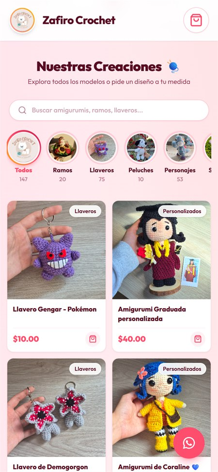
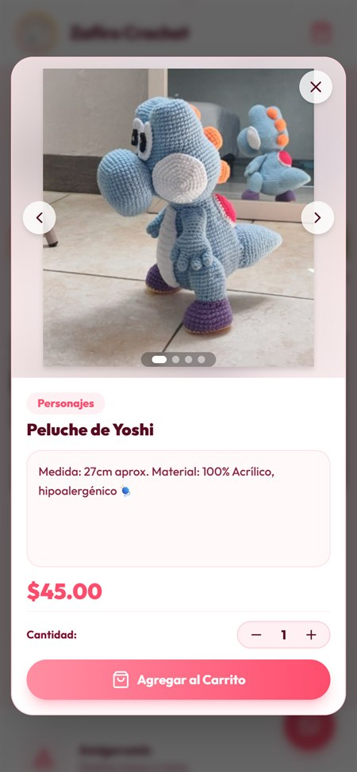

# Zafiro Crochet 🧶

Tienda en línea y panel de administración de **Zafiro Crochet**, una marca de piezas tejidas a mano en Caracas, Venezuela. Los clientes exploran el catálogo y envían su pedido por WhatsApp; la administradora gestiona productos, precios, ofertas y pedidos desde un panel privado, sin tocar código.

---

## Capturas

| Inicio | Catálogo | Producto | Carrito |
| :---: | :---: | :---: | :---: |
|  |  |  |  |

Vista en celular. Haz clic en una captura para verla en tamaño completo.

---

## Funcionalidades

### Tienda

- Inicio con carrusel animado de las creaciones; cada foto abre su producto.
- Categorías estilo *historias destacadas* de Instagram, con foto de portada y contador generados a partir del catálogo.
- Búsqueda en tiempo real con sugerencias, tolerante a acentos.
- Sección de ofertas dinámica: muestra los productos que la administradora marque en oferta.
- Detalle de producto con galería de fotos, descripción y selector de cantidad.
- Carrito persistente con opción de caja de regalo.
- Envío del pedido a WhatsApp con el detalle formateado y un saludo según la hora del día.

### Panel de administración

- Acceso con usuario y contraseña mediante **Supabase Auth**.
- Crear, editar y eliminar productos, con varias fotos y varias categorías por producto.
- Marcar o quitar ofertas con un toque; el precio anterior se calcula automáticamente.
- Pedidos pendientes con semáforo de estatus: 🔴 por empezar, 🟡 en proceso, 🟢 listo.

### Rendimiento y seguridad

- **Row Level Security** en Supabase: el catálogo es de lectura pública y solo la administradora puede modificarlo.
- Las fotos se cargan a medida que se hace scroll (*lazy loading*).
- Las fotos subidas desde el panel se ajustan automáticamente a 1600 px antes de guardarse (de ~8 MB a ~500 KB, sin diferencia visible).

---

## Tecnologías

| Capa | Herramienta |
| :--- | :--- |
| Frontend | React 18 + Vite |
| Estilos | Tailwind CSS |
| Base de datos | Supabase (PostgreSQL + Row Level Security) |
| Autenticación | Supabase Auth |
| Imágenes | Supabase Storage |
| Iconos | Lucide React |
| Despliegue | Vercel |

---

Sigue a la marca en [Instagram (@zafirocrochet_ve)](https://www.instagram.com/zafirocrochet_ve/)

&copy; Zafiro Crochet · Caracas, Venezuela
